# UX and UI review

This review covers the six points in the Assignment 2 brief: hierarchy, contrast, spacing, consistency,
accessibility and behaviour on a phone-sized screen. It covers every screen (login, chat, source drawer, admin
documents, admin ratings) in light and dark mode at desktop width (1280 × 800) and at phone width (390 × 844).

## Method

1. Screenshots of every screen were taken with a headless Chromium browser against the running app, with real
   Gemini answers: `before/` holds the screens before the review, `after/` the same screens after the fixes.
2. The LLM agent (Claude) reviewed each screenshot against the six points.
3. Colour contrast was measured, not estimated: each text and background pair was checked against the WCAG 2.1 AA
   minimum of 4.5:1 for normal text.
4. Each fix was applied, the automated tests were run (73 passed), and the screenshots were taken again.

## Findings and changes

| # | Point                   | Finding (before)                                                                                                                       | Change (after)                                                                                                  | Screens                                              |
| - | ----------------------- | -------------------------------------------------------------------------------------------------------------------------------------- | --------------------------------------------------------------------------------------------------------------- | ---------------------------------------------------- |
| 1 | Phone, consistency      | At phone width the admin tables were wider than the screen: document names wrapped one letter per line and the page scrolled sideways. | Below 640 px each document and each rating becomes a card, with a small label above every value.                | `08-admin-phone`                                   |
| 2 | Contrast, accessibility | Dark mode: white text on the Log in, Upload and send buttons was 3.16:1.                                                               | Buttons use a darker blue in dark mode: 5.90:1.                                                                 | `01-login-desktop-dark`, `08-admin-desktop-dark` |
| 3 | Contrast                | Light mode: grey table headers were 4.28:1 and the "Project A" badge 4.48:1.                                                           | Grey text darkened slightly (4.74:1 on the table header); badge text uses a darker blue (5.82:1).               | `08-admin-desktop`                                 |
| 4 | Accessibility           | Moving through the page with the Tab key had no consistent visible focus on buttons, chips and links.                                  | Every focusable element shows the same blue focus ring.                                                         | all                                                  |
| 5 | Hierarchy               | The source drawer showed raw Markdown (`#`, `##`), so the document's headings did not stand out.                                   | Headings are shown as bold headings without the `#` signs.                                                    | `07-chat-source-drawer-*`                          |
| 6 | Hierarchy, behaviour    | "No answer found." gave no reason and no next step.                                                                                    | A short line below it explains that the accessible documents do not cover the question and suggests what to do. | `05-chat-no-answer-*`                              |

### Before and after

Findings 3 and 4 are not shown here: the contrast change is too small to see in a screenshot (it was measured),
and the focus ring only appears while moving through the page with the Tab key.

**1. Admin page at phone width:** the table became cards.

| Before | After |
|--------|-------|
| 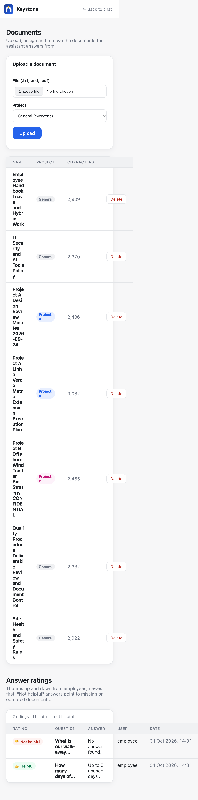 | 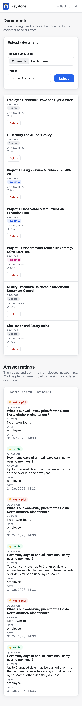 |

**2. Button contrast in dark mode:** 3.16:1 → 5.90:1.

| Before | After |
|--------|-------|
| 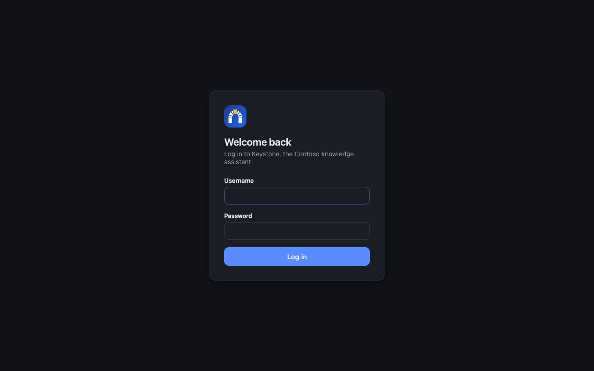 |  |

**5. Source drawer:** headings instead of raw Markdown.

| Before | After |
|--------|-------|
| 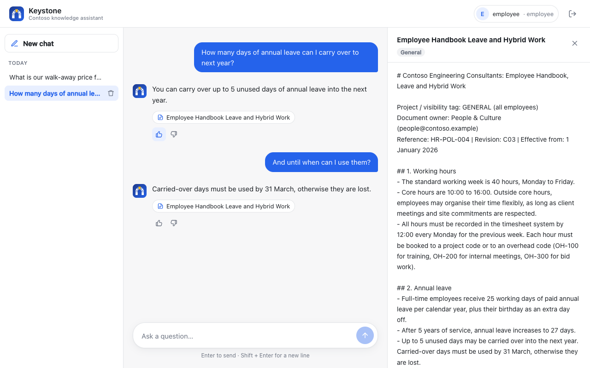 | 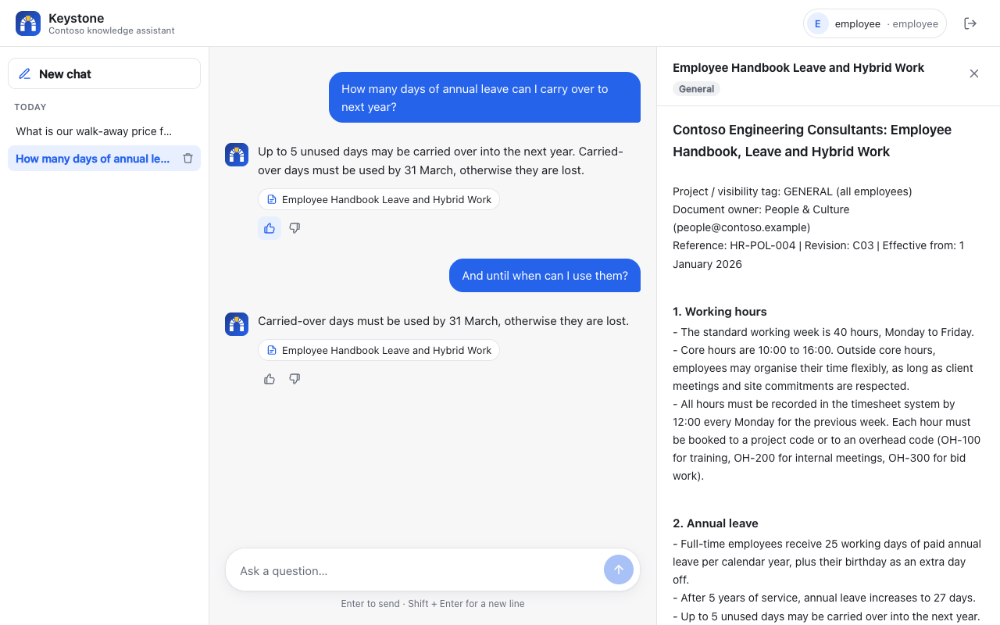 |

**6. "No answer found.":** now says why and what to do next.

| Before | After |
|--------|-------|
| 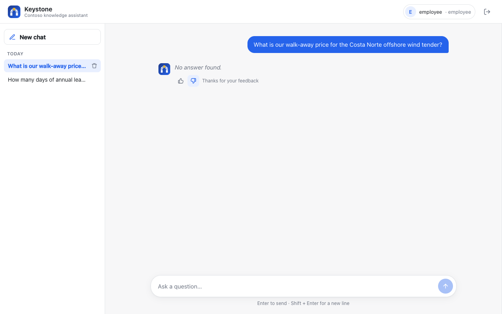 | 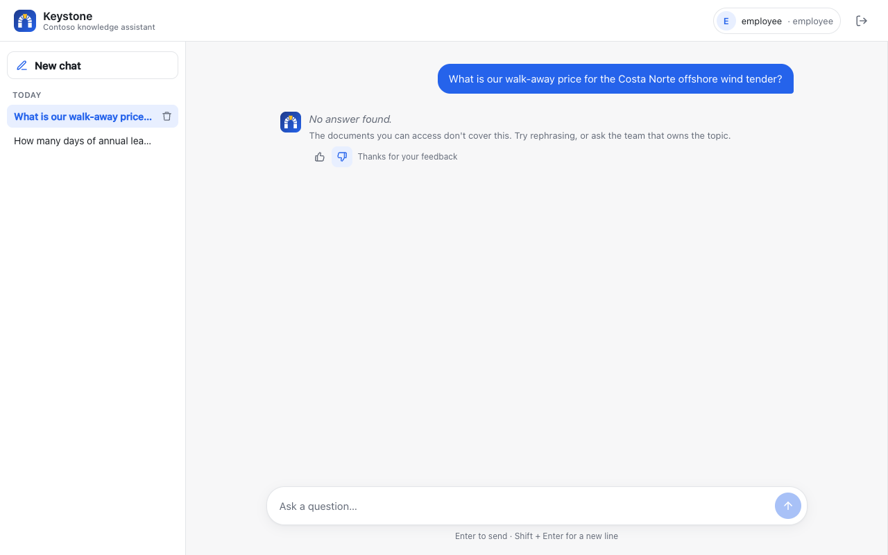 |

Checked and left unchanged:

- **Hierarchy:** one clear main action per screen (Log in, the question box, Upload); answers, sources and ratings
  read top to bottom in that order.
- **Spacing:** consistent card padding (20 px) and gaps between messages on every screen.
- **Consistency:** the same card, badge and button styles on the chat and admin pages, in light and dark mode.
- **Contrast** of the other pairs: muted text 4.52:1 → 5.01:1 on the page, user bubble 5.17:1, Project B badge
  5.31:1, Helpful 5.40:1, Not helpful 6.05:1, and all dark-mode text above 4.5:1.
- **Accessibility:** every input has a label, icon buttons have an `aria-label`, the login error is announced
  (`role="alert"`), and Escape closes the sidebar and the source drawer.

## Comparison with the Assignment 1 mockups

I compared each MVP screen with the matching Assignment 1 slide myself. Slides 8 and 9 were screenshots of the
prototype, in dark mode, so I compare them with the dark-mode MVP screens. Slide 10 held wireframes for the admin
and meeting screens.

### Login (slide 8)

| Assignment 1 | MVP |
|--------------|-----|
| 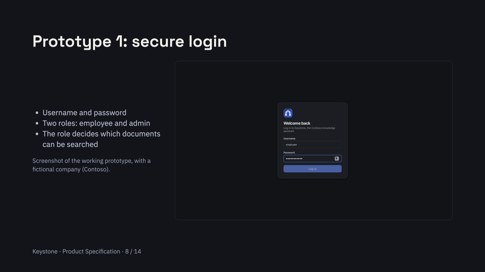 |  |

The layout is the same: one card with the logo, username, password and a single Log in button. In the prototype
the button was a pale blue that looked disabled; in the MVP it is a stronger blue that passes the contrast check.
The MVP also tells the user what went wrong: a wrong password, a server failure or no connection each have their
own message.

### Chat (slide 9)

| Assignment 1 | MVP |
|--------------|-----|
| 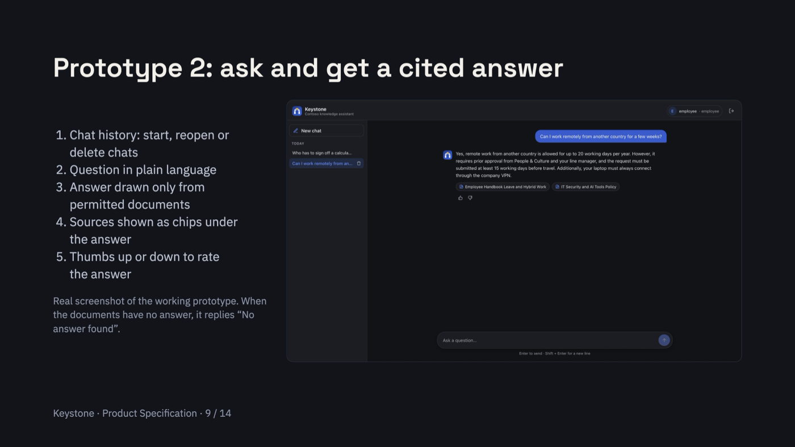 | 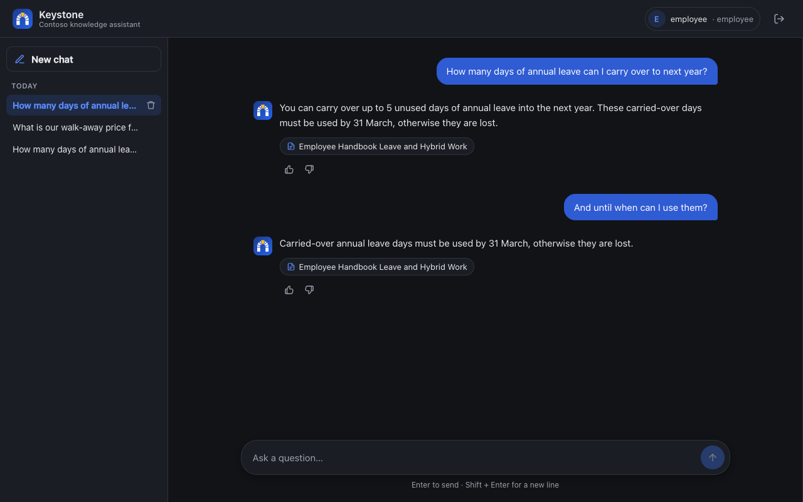 |

I kept the five elements from slide 9: chat history, plain-language question, answer only from permitted
documents, source chips and thumbs up or down. Three things are new: clicking a source chip opens the document
next to the answer, so the user can check it; follow-up questions ("And until when can I use them?") are
understood; and "No answer found." now explains why. The chat also works at phone width, with the history in a
menu.

### Admin (slide 10)

| Assignment 1 | MVP |
|--------------|-----|
| 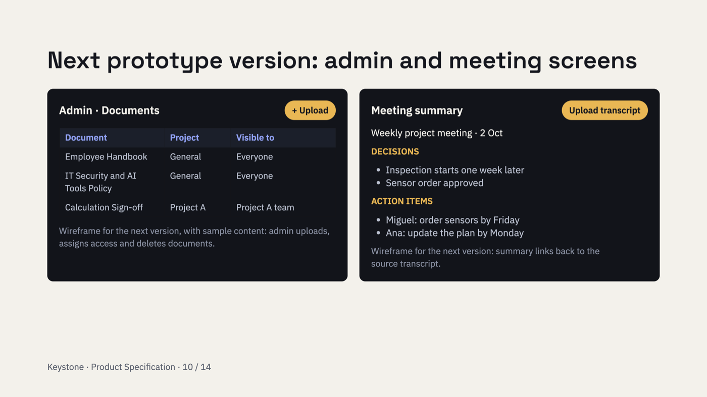 | 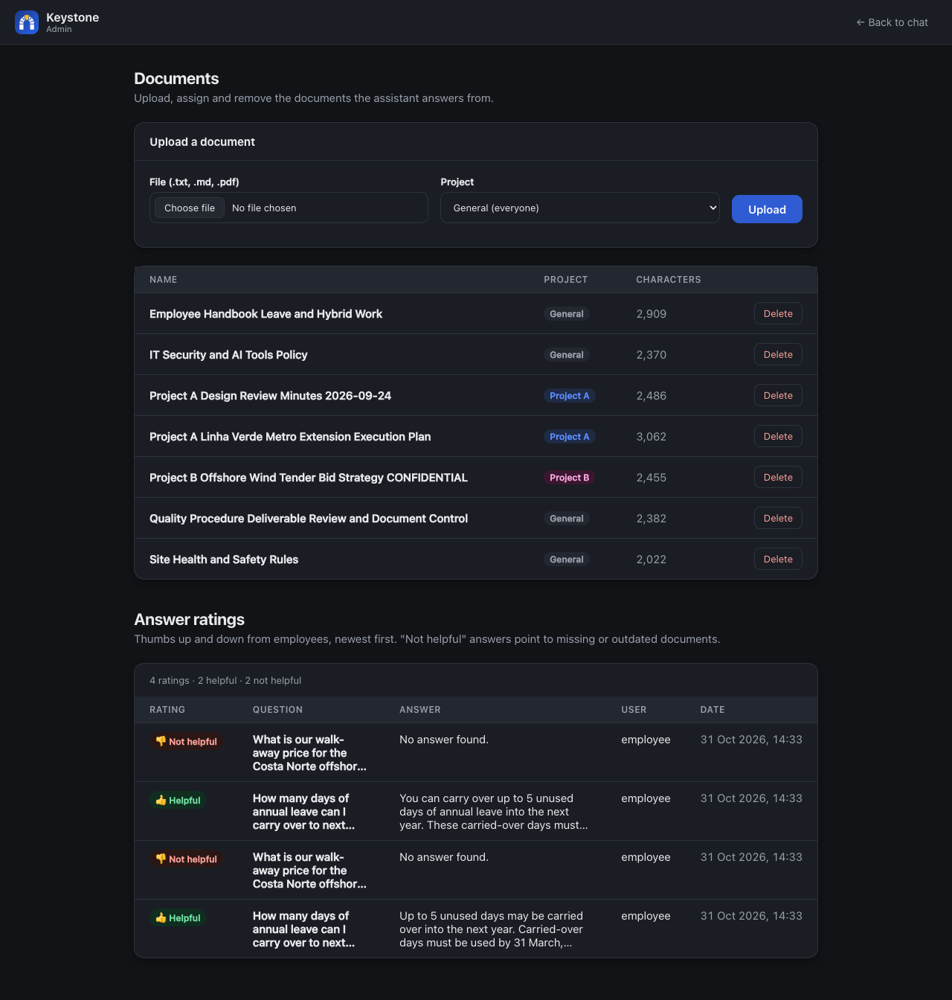 |

The wireframe had a "+ Upload" button and a "Visible to" column. In the MVP the upload is a form above the table,
so the admin picks the file and the project in one step and sees straight away which project the document goes
to. "Visible to" became a coloured project badge, because the project is what decides who can see a document.
The answer ratings were not in the mockups (S1 only said "visible to the admin"); I added them below the
documents, so the admin has everything on one page. The meeting summary screen on the same slide was not built
because S3 is outside the MVP.

### Summary

| Screen                                | Assignment 1                                                              | MVP                                                                                | Difference                                                                                 |
| ------------------------------------- | ------------------------------------------------------------------------- | ---------------------------------------------------------------------------------- | ------------------------------------------------------------------------------------------ |
| Login (slide 8)                       | Username, password, two roles                                             | Same, plus clear messages for a wrong password, a server failure and no connection | Same layout                                                                                |
| Chat (slide 9)                        | Chat history, question box, answer with source chips, thumbs up/down      | Same, plus the source drawer, the "No answer found." explanation and phone layout  | Same layout                                                                                |
| Admin documents (slide 10, wireframe) | Columns Document · Project · Visible to; Upload button at the top right | Columns Name · Project · Characters · Delete; upload form above the table       | "Visible to" is shown only through the project badge; upload is a form instead of a button |
| Admin ratings                         | Not in the mockups (S1 said "visible to the admin")                       | Ratings section below the documents                                                | New screen                                                                                 |
| Meeting summary (slide 10, wireframe) | Upload transcript, decisions, action items                                | Not built                                                                          | Deferred with S3                                                                           |
